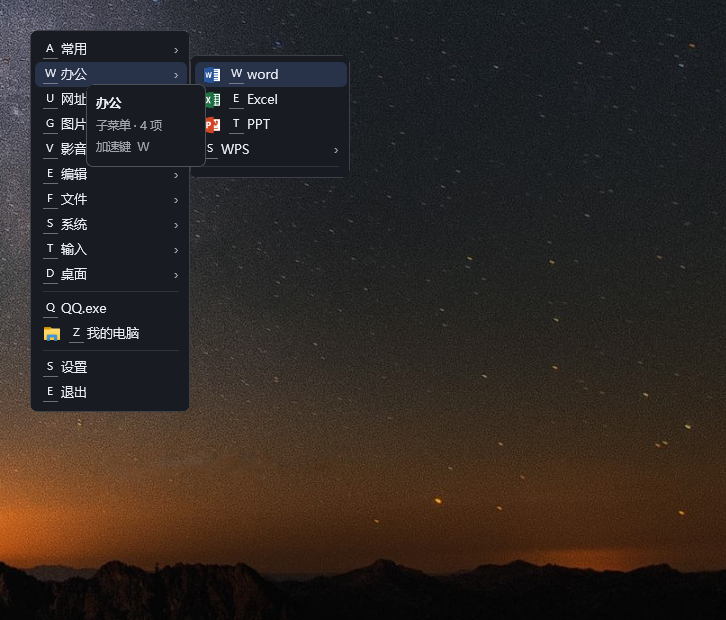

# RunAny_RS

**一个用 Rust + GPUI 写的 Windows 弹出式菜单** —— 按一个键，菜单在鼠标旁边摊开，点一下就跑。

常驻托盘、随叫随到，把常用操作压成「一次按键 + 一次点击」。


<p align="center"><sub>深色主题（可跟随系统明暗）</sub></p>



---

## 和原版 RunAny 的关系

[RunAny](https://github.com/hui-Zz/RunAny) 是这套交互的原创者（AutoHotkey 写的，功能极全）。
本项目是同一套思路的**重写**：界面和配置系统重做，底层换成 Rust + GPUI 原生渲染。

| | 原版 RunAny | **RunAny_RS** |
|---|---|---|
| 运行环境 | 需要 AutoHotkey | **单个 exe**，不依赖任何运行时 |
| 界面渲染 | AHK 控件 / 自绘 | **GPUI 原生 GPU 渲染**，圆角、明暗主题、跟随系统 |
| 配置格式 | `.ini` | **JSON**（`settings.json` + `menus/*.runa`，可读、可 diff、可进版本管理） |
| 菜单项编辑器 | 直接改 ini | **图形编辑器**：拖拽排序、多选批量、每条动作单独测试、实时预览 |
| 多套菜单 | 换 ini 文件 | **内置配置切换**，菜单项可整棵复制成 JSON 分享 |
| 选中内容判断 | 正则为主 | **一键直达规则表**：正则/网址/文件/颜色/JSON/IP/后缀… + 多行匹配 + 拖拽排序 |
| 从文件夹生成菜单 | 有 | 有，且支持「仅当前层 / 含子目录」+ 三种生成时机，**不污染配置文件** |
| 占位符 | AHK 变量 | `{selection}` `{env:NAME}` `{rust:...}` **`{ahkvar:A_YYYY}`**（AHK v2 内置变量照用） |
| 插件生态 | 丰富 | 暂无（脚本类需求写 AHK v1/v2 脚本动作即可） |
| 导入原版配置 | — | **直接读 `RunAny.ini`**，菜单树 / 加速键 / 插件调用都搬过来 |

**一句话**：功能覆盖面接近原版，换来的是「开箱即用、界面现代、配置干净」。

---

## 特性

| | |
|---|---|
| **弹出菜单** | 全局快捷键唤出，多列级联，自动避让屏幕边缘 |
| **选中什么弹什么** | 同一颗键，选中文件 / 选中文字 / 什么都没选，弹出来的菜单可以完全不同（每项可设「使用条件」，剪贴板里是图片、路径也能当条件） |
| **界面** | GPUI 原生渲染：圆角卡片、明暗双主题（可跟随系统）、悬停提示卡、平滑级联，不是 AHK 控件拼的 |
| **三套触发方式** | 全局快捷键 / 局部快捷键（只在某些窗口生效）/ 热字符串（`::ftw::` 那种） |
| **六种动作** | 运行程序、打开网址、发送按键、发送文本、内置动作、运行脚本（AHK v1/v2） |
| **动作链** | 一项可挂多条动作，按顺序执行、每条可设延迟，每条都能单独「测试」 |
| **一键直达** | 抓选中内容 → 按规则表判断（正则/网址/文件/颜色/JSON/IP…）→ 直接执行，不弹菜单 |
| **从文件夹自动生成** | 子菜单内容由文件夹决定：仅当前层或含子目录，手动 / 实时 / 仅启动时 |
| **占位符** | `{selection}` `{clipboard}` `{exe_dir}` `{env:TEMP}` `{ahkvar:A_YYYY}` … |
| **导入原版配置** | 直接读 RunAny 的 `RunAny.ini`，菜单和快捷键一次搬过来 |

---

## 快速开始

**用现成的**：下载 release 里的 `RunAny_RS-win64-*.zip`，解压到任意目录，双击 `RunAny_RS.exe`。
首次运行会在同目录生成 `settings.json` 和 `menus/默认.runa`。

**自己编译**：

```bash
git clone https://github.com/lch319/RunAny_RS.git
cd RunAny_RS
cargo build --release
# 产物：target/release/RunAny_RS.exe
```

需要 Rust 1.75+ 和 Windows 10/11。`third_party/everything-sdk/Everything64.dll` 要跟 exe 放在一起
（「运行程序」只写文件名时靠它解析成完整路径）。

---

## 默认键

| 键 | 作用 |
|---|---|
| `` ` `` | 弹出完整菜单（在 **设置 → 常规** 里改） |
| 托盘图标 左键 | 同上；右键是托盘菜单 |

---

## 文档

完整用法都在 **[docs/使用说明.md](docs/使用说明.md)**：

- [界面总览](docs/使用说明.md#界面总览)
- [菜单项：层级 / 拖拽 / 批量操作](docs/使用说明.md#菜单项)
- [六种动作与占位符](docs/使用说明.md#动作)
- [三种触发方式](docs/使用说明.md#触发方式)
- [生效条件怎么写](docs/使用说明.md#生效条件)
- [一键直达规则表](docs/使用说明.md#一键直达)
- [从文件夹自动生成](docs/使用说明.md#从文件夹自动生成)
- [从原版 RunAny 导入](docs/使用说明.md#导入原版配置)
- [配置文件在哪 / 怎么备份](docs/使用说明.md#配置文件)
- [常见问题](docs/使用说明.md#常见问题)

---

## 许可

MIT。

> 第三方组件：[GPUI](https://github.com/zed-industries/zed)（Apache-2.0）、
> [Everything SDK](https://www.voidtools.com/support/everything/sdk/)（voidtools 的许可，
> DLL 见 `third_party/everything-sdk/`）。
