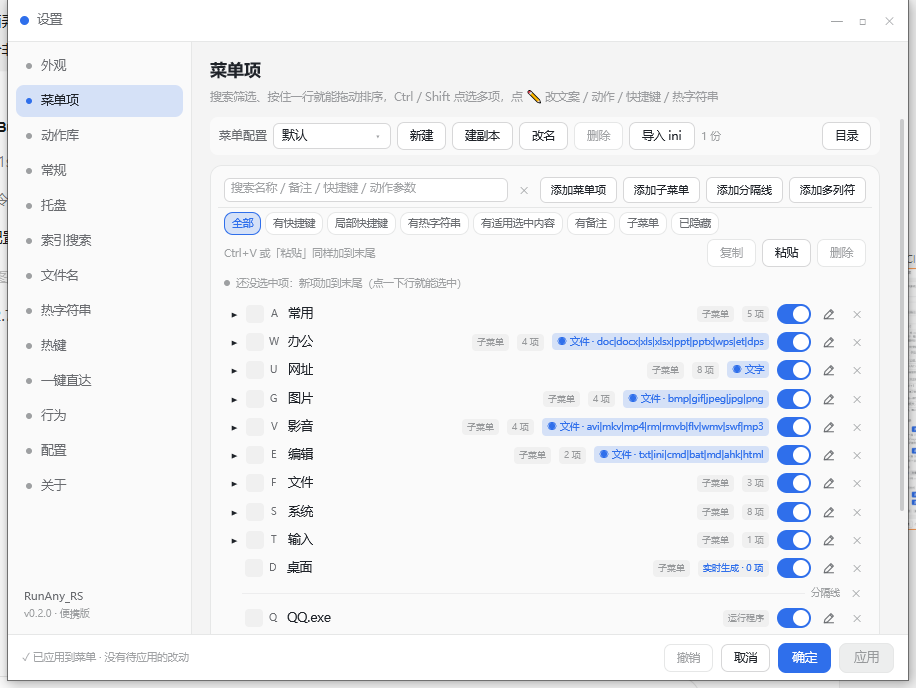
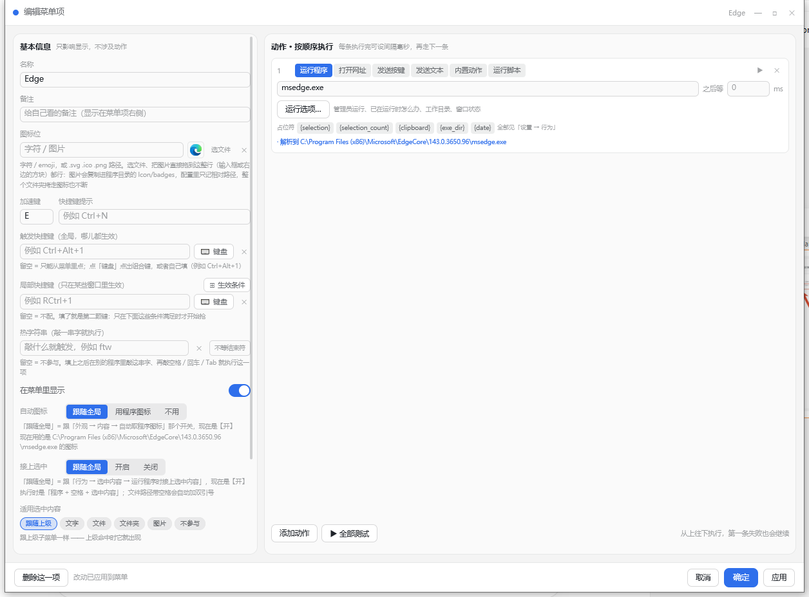
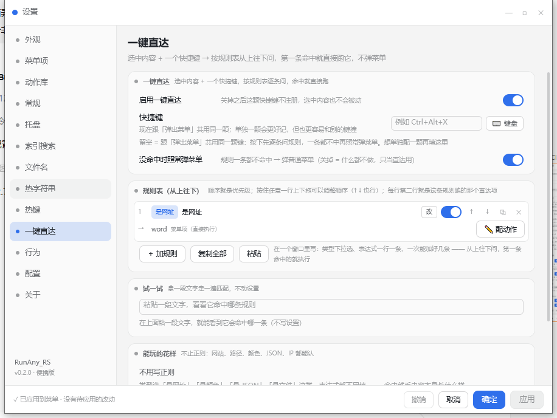

# RunAny_RS 使用说明

> 这是详细手册。想快速了解这软件是干什么的，先看 [README](../README.md)。

目录

- [安装与首次运行](#安装与首次运行)
- [界面总览](#界面总览)
- [菜单项](#菜单项)
- [动作](#动作)
- [触发方式](#触发方式)
- [生效条件](#生效条件)
- [一键直达](#一键直达)
- [从文件夹自动生成](#从文件夹自动生成)
- [托盘](#托盘)
- [导入原版配置](#导入原版配置)
- [配置文件](#配置文件)
- [常见问题](#常见问题)

---

## 安装与首次运行

1. 解压 `RunAny_RS-win64-*.zip` 到任意目录（**别放在需要管理员权限的目录**，比如 `C:\Program Files`）。
2. 双击 `RunAny_RS.exe`。程序没有主窗口，只会出现在托盘里。
3. 按默认键 <kbd>`</kbd>（反引号，Esc 下面那颗）就能弹出菜单。

首次运行会在 exe 同目录生成：

```
RunAny_RS.exe
Everything64.dll        ← 「只写文件名」时用来解析完整路径
settings.json           ← 外观、快捷键、各种开关
menus/默认.runa          ← 菜单项本体（一棵树）
Icon/                   ← 自定义图标（用到才会建）
```

> **想开机自启**：设置 → 常规 → 开机自启。用的是注册表启动项，不需要管理员。

---

## 界面总览

左栏是页面，右栏是内容。所有改动点右下角 **应用 / 确定** 才落盘，点 **取消** 全部回滚。

| 页面 | 管什么 |
|---|---|
| 外观 | 字体、行高、圆角、深浅色、面板宽度、悬停提示模板 |
| 菜单项 | **菜单本体**：增删改、拖拽排序、批量操作、快捷键、热字符串 |
| 动作库 | 现成的内置动作清单，可直接「添加到菜单」 |
| 常规 | 弹出键、开机自启、双击行为、最近运行 |
| 托盘 | 托盘图标、左右键行为 |
| 索引搜索 | Everything 连接状态、程序搜索规则 |
| 文件名 | 菜单里所有裸文件名各自解析到哪、同名有几份 |
| 热字符串 | 全局热字符串开关、结束键 |
| 热键 | 所有快捷键一览、冲突检查 |
| 一键直达 | 规则表 |
| 行为 / 配置 / 关于 | 抓取选中内容、配置导出、版本信息 |



---

## 菜单项

### 层级

一个节点只有三种身份：**菜单项 / 子菜单 / 分隔线**。

- 有子项 → 自动是子菜单；子项被搬空 → 仍是子菜单，但**菜单里会隐藏**（设置页给红色胶囊「还没有菜单项」）
- 子菜单**可以空着**，加了项才出现在菜单里
- 双击行（或按 <kbd>Enter</kbd>、<kbd>F2</kbd>）打开编辑窗口——名称、图标、快捷键、动作都在那儿

### 拖拽与批量

- **按住任意一行上下拖**＝调整顺序（拖到目标行的上/下半区决定插前面还是后面）
- <kbd>Ctrl</kbd> / <kbd>Shift</kbd> 点选多行，工具条上出现 **复制 / 粘贴 / 删除**
- <kbd>Ctrl</kbd>+<kbd>C</kbd> / <kbd>V</kbd>、<kbd>Delete</kbd> 同样可用
- 复制出来的是 JSON，**发给别人他粘进去就能用**（动作、图标、子项都带着）

### 每一行能配什么

| 列 | 说明 |
|---|---|
| 名称 / 加速键 | 加速键是菜单里那一个字母（<kbd>A</kbd>），打开菜单后直接按就能选中 |
| 备注 | 行右侧灰字，只在菜单里显示（不参与搜索以外的事情） |
| 图标 / 角标 | 字符、emoji，或 `.svg/.ico/.png` 路径；图片会复制进 `Icon/`，配置里只记相对路径 |
| 触发快捷键 | 真正注册到系统的键。菜单项：按下直接执行；子菜单：只弹这一支 |
| 局部快捷键 | 同上，但**只在满足生效条件时**才响应（见 [生效条件](#生效条件)） |
| 热字符串 | 敲这几个字母 + 结束键就执行，跨程序生效 |
| 显示开关 | 关掉的项不显示、也不注册它的快捷键 |
| 使用条件 | 「只有选中文件时」「只有选中文字时」这类上下文条件 |

---

## 动作

一项可以挂**多条**动作，从上往下执行，每条之间可设延迟。



| 类型 | 填什么 |
|---|---|
| **运行程序** | `notepad.exe` 或完整路径或一整条 shell 命令。只写文件名时交给 Everything 解析 |
| **打开网址** | `https://…`，也可以是文件/文件夹路径（交给系统默认程序打开） |
| **发送按键** | `Ctrl+S`，多个用空格隔开：`Ctrl+A Delete`。连发写法 `Ctrl+K{K 5}` |
| **发送文本** | 直接当键盘输入打出去（走 Unicode 注入，不碰剪贴板），支持中文 |
| **内置动作** | 动作库里的一条（打开设置、清空回收站、按媒体键…），带自己的参数 |
| **运行脚本** | AutoHotkey v1 / v2 代码，直接写或粘进来 |

**每条动作右上角的 ▶ 是「测试」**：立刻跑这一条，结果写在动作区底部（发送按键 / 发送文本类
会把内容打进当前窗口，测试时先把光标放到记事本里）。底部 **▶ 全部测试** 按顺序全跑一遍。

### 运行程序的两个细节

- **裸文件名**：底下实时显示 `解析到 C:\…\notepad.exe`，解析不到会红字提示
- **运行选项**：管理员运行、已在运行时怎么办、工作目录、窗口状态

### 占位符

写在参数里，执行那一刻才替换（脚本动作只认 `%getZz%`，不碰 `{}`）。

| 写法 | 值 |
|---|---|
| `{selection}` / `%getZz%` | 弹出菜单前抓到的选中内容（文字原文 / 文件路径） |
| `{selection_kind}` `{selection_count}` | 选中内容的类型 / 文件个数 |
| `{clipboard}` | 当前剪贴板文本 |
| `{exe_dir}` `{exe_path}` `{config}` | 程序目录 / 程序路径 / 配置文件路径 |
| `{date}` `{time}` `{year}` `{month}` `{day}` | 当前日期时间 |
| `{cursor_x}` `{cursor_y}` | 鼠标屏幕坐标 |
| `{path: QQ.exe}` | 把文件名解析成完整路径 |
| `{env:USERPROFILE}` / `{env:XXX\|默认值}` | 系统环境变量 |
| `{rust:pid}` `{rust:version}` … | 程序自己算的值（pid / version / arch / now_unix / cpus / user / host / profile …） |
| `{ahkvar:A_YYYY}` | AutoHotkey v2 的内置变量：`A_YYYY A_MM A_DD A_Hour A_Min A_Sec A_Now A_NowUTC A_WDay A_YDay A_DDD A_DDDD A_TickCount A_ScriptDir A_ScriptName A_Desktop A_MyDocuments A_Temp A_WinDir A_ProgramFiles A_AppData A_UserName A_ComputerName A_OSVersion A_IsAdmin A_Clipboard A_Space A_Tab A_LineEnding` |

认不出来的占位符会**原样保留**，一眼能看出没生效。

---

## 触发方式

### 1. 弹出菜单

设置 → 常规 → 弹出键。默认 <kbd>`</kbd>。

### 2. 菜单项的快捷键

编辑器里「触发快捷键」：

- **菜单项**：按下 → 抓选中的内容 → 直接执行它的动作链（不弹菜单）
- **子菜单**：按下 → 只把这一个子菜单摊开（不是整张菜单）

「局部快捷键」是同一个东西，但多一个生效条件——比如只在 VS Code 里响应的 <kbd>F1</kbd>。

> 只有动作里真的用得上选中内容时（有 `{selection}`、或动作是「运行程序」），
> 按快捷键才会发 Ctrl+C 去抓；「发送按键」这类不会白等半秒。

### 3. 热字符串

编辑器里「热字符串」填 `ftw`，在**任何程序**里敲 `ftw` 再敲空格/回车/Tab 收尾，这几个字母
会被删掉，换成这一项的动作。适合做「缩写展开」：动作填「发送文本」，内容写要展开的那段话。

---

## 生效条件

给「局部快捷键」用。一行一条（行与行是**或**，同一行里 `&&` 是且、逗号是或）：

```
exe:vscode.exe && title:*.py
mouse.exe:notepad.exe
ctrl:Button            ← 光标下控件的类名
class:Chrome_WidgetWin_1
!exe:explorer.exe
```

| 前缀 | 看什么 |
|---|---|
| `exe:` | 进程名（`code.exe`） |
| `path:` | 完整路径 |
| `title:` | 窗口标题 |
| `class:` | 窗口类名 |
| `ctrl:` | **活动窗口里**光标底下那个控件的类名 |

前面加 `mouse.`（`mouse.exe:` / `mouse.title:` / `mouse.class:` / `mouse.path:` / `mouse.ctrl:`）
就改成看「鼠标底下那扇窗口」——即使焦点在别的程序里。

**值怎么写**：默认「包含」，`*` `?` 通配，`=x` 全等，`/正则/` 正则，`"引号"` 原样比，前面加 `!` 取反。

界面上「怎么写」那段可以在窗口右侧现场复制，条件编辑窗口里还有「从当前窗口取」的快捷按钮。

---

## 一键直达

一句话：**抓一段选中内容 → 按规则从上往下判断 → 第一条命中的就把它的菜单项跑掉**，不弹菜单。



- **一条规则配一个菜单项**：新建规则时会顺手把「命中之后跑的那一项」建好，规则窗口里只显示它，
  点「✎ 配动作」去配
- **判断方式**：正则、包含、开头、结尾、通配、网址、文件、文件夹、后缀、路径、颜色、IP、JSON、邮箱、UUID、数字、任意
- **多行匹配**：抓到的内容经常是好几行（多选的文件、邮件原文），打开后正则里 `.` 能跨行
- **顺序 = 优先级**，按住任意一行上下拖可以调整
- **复制 / 粘贴**：整份规则打包成 JSON（连菜单项、动作一起），发给别人他粘进去就能用；
  每条规则右边的 ⧉ 是只复制这一条

「试一试」那一栏可以粘一段文字，看它会命中哪条规则（不改任何设置）。

---

## 从文件夹自动生成

子菜单的内容可以交给文件夹决定：编辑器 →「从文件夹自动生成」。

| 设置 | 说明 |
|---|---|
| 方式 | **手动生成**（点按钮，只补缺）/ **实时生成**（每次呼出菜单前重建）/ **仅开启软件时**（启动时重建一次） |
| 范围 | **仅当前文件夹**（默认）/ 含子文件夹 |
| 后缀 | `mp4\|mkv`（老写法 `mp4 mkv` 也认），留空 = 所有文件 |
| 最多 | 一个文件夹最多收几条（留空 = 500） |
| 写入 | 完整路径 / 只写文件名 |

**重要**：实时生成 / 仅开启软件时这两种，生成结果**只在内存里**，不写进配置——
所以 `settings.json` 不会反复变化，设置页也不会一直闪。这两种模式下这个子菜单**不能手动加项**，
加了下次呼出就会被清掉，所以干脆拦下来。

文件太多被截断时，菜单末尾会自动补一条「还有更多没列出…（打开这个文件夹）」。

文件夹那栏支持占位符，例如 `{exe_dir}\影片`、`{env:USERPROFILE}\Desktop`。

---

## 托盘

- 左键：弹出完整菜单（可改成「最近运行」或不管）
- 右键：托盘菜单，**跟你自己的菜单同一套编辑器**（设置 → 托盘 里配）

---

## 导入原版配置

设置 → 菜单项 → **导入 ini**，选原版 RunAny 的 `RunAny.ini`：

- 菜单树、层级、加速键照样搬过来
- 快捷键能转的转成组合键，转不出来的写成提示
- 插件调用（`XiaoYao_plus[xxx](...)`）会落成内置动作「执行原版插件功能」，参数原样保留
  （这个动作目前**还没接通**，只存不跑）

---

## 配置文件

| 路径 | 内容 |
|---|---|
| `settings.json` | 外观、快捷键、开关、一键直达规则、托盘菜单 |
| `menus/*.runa` | 菜单项本体，一套配置一个文件（可以建多套，随时切） |
| `Icon/` | 自定义图标（图片会自动复制进来，配置里只记相对路径） |
| `program-fixes.json` | 「这个裸文件名我指定用哪一份」的修正表 |

**备份 / 迁移**：整个目录拷走就行。**分享给别人**：只拷 `settings.json` + `menus/` 也行，
但注意里面可能有你这台机器的路径。

---

## 常见问题

**按了键没反应？**
看设置 → 热键，那里有冲突检查（被别的软件占用会标红）。另外有些游戏 / 安全软件会拦全局钩子。

**「运行程序」写的文件名找不到？**
需要 Everything 在跑（它负责把裸文件名解析成完整路径）。设置 → 索引搜索 能看到连接状态；
也可以直接写完整路径。

**菜单弹出来很慢？**
「实时生成」的子菜单越多、文件夹越大，呼出时那一刷就越久。可以给每支设「最多 N 项」，
或者改成「仅开启软件时生成」。

**重复打开会开两个？**
不会。程序是单实例的：再次启动会把旧的那个关掉再接管。

**怎么彻底卸载？**
退出程序，删掉整个目录。开机自启的话先去设置里关掉。
